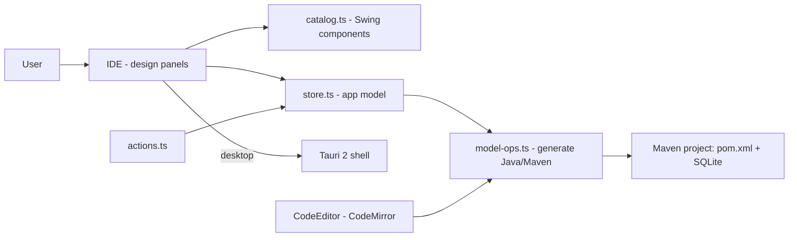

# javaforge

**English** · [Português (Brasil)](README.md)

[](#) [](#) [](#) [](#) [](#) [](LICENSE)

## What it is

**JavaForge** is a **visual development IDE/tool** for building Java **Swing** applications with an embedded **SQLite** database without writing everything by hand: the user drags components (JButton, JLabel, JTextField, JPanel…), connects events without code, and the app **generates a complete Maven project** (`pom.xml` + wrapper) that can be run and later edited in code. It is a desktop product (Tauri 2) that also runs as a web app in the browser.

> Note: the previous README described a **finance dashboard** (with Recharts and a rule-based AI assistant) — it does not exist in this repository. Corrected.

## Status

Actively in development, working. Tested (69 tests) and with a validated build.

## Features

- **Swing component palette**: drag and position JButton, JLabel, JTextField, JPanel and others onto a 10-px-grid design bench.
- **No-code event connections**: wire component actions to app logic without typing.
- **Code editor** (CodeMirror, VS Code Dark+ theme) with Java code generation.
- **Embedded SQLite**: a data panel that writes to the app's database.
- **Maven project generation**: build options (`maven` → generates `pom.xml` + `mvnw`/`mvnw.cmd`; `none` → plain `javac` with the embedded SQLite driver).
- **Run/stop the generated project**, save, open recent projects, regenerate.
- **Single high-contrast dark theme** ("forge" identity, amber #f5a524); design decisions documented in `DESIGN.md`.
- **Tauri 2 desktop app** (window, dialogs, open file) with a Vite web fallback.

## Architecture

A React/TypeScript app with an IDE panel layout (design bench, palette, properties, data, console). The app model lives in a store (`store.ts`), actions are centralized in `actions.ts`, the component catalog in `catalog.ts`, and code generation in `model-ops.ts`. The desktop wrapper is Tauri 2 (`src-tauri`).



## Stack

- React 18.3, TypeScript 5.x
- Vite 5, CodeMirror 6 + `@codemirror/lang-java`
- Tauri 2 (`@tauri-apps/api`, `plugin-dialog`, `plugin-opener`)
- Tests: Vitest 2 + Testing Library + jsdom
- No Tailwind (custom IDE styling, see `DESIGN.md`)

## Repository layout

```
javaforge/
├── src/
│   ├── App.tsx · main.tsx
│   ├── actions.ts · store.ts · catalog.ts · model-ops.ts
│   ├── designer/Designer.tsx      # design bench (drag & drop)
│   ├── editor/CodeEditor.tsx      # CodeMirror Java editor
│   ├── ide/IDE.tsx                # IDE shell (tabs, status, title)
│   ├── panels/                    # Catalog, Data, Database, Migration…
│   ├── start/StartScreen.tsx      # create/open project
│   └── *.test.ts                  # tests (model, actions, catalog, store)
├── src-tauri/                     # Tauri 2 desktop wrapper
├── DESIGN.md                      # design direction (theme, type, layout)
├── package.json · vite.config.ts
└── LICENSE                        # MIT
```

## Prerequisites and installation

Node.js (npm). For the desktop build, also [Rust + Tauri prerequisites](https://tauri.app/start/prerequisites/).

```bash
git clone https://github.com/KelvinOliveiraCode/javaforge.git
cd javaforge
npm install
```

## How to run

```bash
npm run dev        # web app in the browser (Vite)
npm run build      # production build (tsc --noEmit && vite build), validated by the agent
npm test           # vitest run
npm run tauri dev  # desktop app (Tauri 2)
npm run tauri build
```

## Tests and quality

Real run (verified by the agent):

```bash
npm test
# 69 passed (5 files): catalogFilter 7, store 20, model-ops 29, actions 2, catalog 11
npm run build
# built in 3.15s
```

There is no CI configured in this repository.

## Technical decisions and trade-offs

- **Same code for web and desktop** (Tauri 2): one React frontend that also packages as a native app; the cost is the Tauri shell overhead.
- **Dark tool design, no toggle**: for long sessions and coherence with the generated code (VS Code theme); decisions and reasons in `DESIGN.md`.
- **UI elements that generate real code**: the bench is not just visual — the model becomes an executable Maven project.
- **CodeMirror editor themed like VS Code**: generated code "does not change home" when entering the app.

## Known limitations and roadmap

- Generates Java Swing + SQLite apps; it does not cover all Swing components/frameworks.
- Product in development; the web build is validated, but the full desktop flow depends on the Rust/Tauri toolchain.
- No end-to-end UI tests — the current suite covers model, actions and catalog.

## Development process

An individual project by Kelvin Oliveira, built with orchestrated AI agents and reviewed by the author. The builder architecture, the Maven code generation and the review are the author's.

## License and author

MIT — Copyright (c) 2026 Kelvin Rebelo de Oliveira.

**Author**: [Kelvin Oliveira](https://github.com/KelvinOliveiraCode) · [Portfolio](https://kelvinoliveiracode.github.io/portfolio/)
