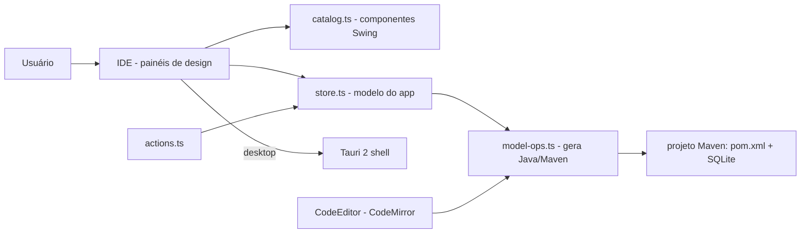

# javaforge

[English](README.en.md) · **Português (Brasil)**

[](#) [](#) [](#) [](#) [](#) [](LICENSE)

## O que é

**JavaForge** é uma **IDE/ferramenta visual de desenvolvimento** para montar aplicativos Java Swing com banco **SQLite** sem escrever tudo na mão: o usuário arrasta componentes (JButton, JLabel, JTextField, JPanel…), conecta eventos sem código e o app **gera um projeto Maven completo** (`pom.xml` + wrapper) que pode ser rodado e depois editado no código. É um produto desktop (Tauri 2) que também roda como web app no navegador.

> Nota: o README anterior descrevia um **dashboard financeiro** (com Recharts e assistente IA por regras) — não existe neste repositório. Corrigido.

## Status

Em desenvolvimento ativo, funcional. Testado (69 testes) e com build validado.

## Funcionalidades

- **Paleta de componentes Swing**: arrastar e posicionar JButton, JLabel, JTextField, JPanel e outros em uma bancada de design com grade de 10 px.
- **Conexões de eventos sem código**: ligar ações dos componentes à lógica do app sem digitar.
- **Editor de código** (CodeMirror, tema VS Code Dark+) com geração de código Java.
- **Banco SQLite embutido**: painel de dados que grava no banco do app.
- **Geração de projeto Maven**: opções de build (`maven` → gera `pom.xml` + `mvnw`/`mvnw.cmd`; `none` → `javac` direto com driver SQLite embutido).
- **Rodar/parar o projeto gerado**, salvar, abrir projetos recentes, regenerar.
- **Tema único escuro de alto contraste** (identidade "forja", âmbar #f5a524), decisões de design documentadas em `DESIGN.md`.
- **Aplicativo desktop via Tauri 2** (janela, diálogos, abrir arquivo) com fallback web (Vite).

## Arquitetura

App React/TypeScript com editor IDE em painéis (bancada de design, paleta, propriedades, dados, console). O modelo de app é mantido em um store (`store.ts`), ações centralizadas em `actions.ts`, catálogo de componentes em `catalog.ts`, geração de código em `model-ops.ts`. O wrapper desktop é Tauri 2 (`src-tauri`).



## Stack

- React 18.3, TypeScript 5.x
- Vite 5, CodeMirror 6 + `@codemirror/lang-java`
- Tauri 2 (`@tauri-apps/api`, `plugin-dialog`, `plugin-opener`)
- Testes: Vitest 2 + Testing Library + jsdom
- Sem Tailwind (estilo próprio da IDE, ver `DESIGN.md`)

## Estrutura do repositório

```
javaforge/
├── src/
│   ├── App.tsx · main.tsx
│   ├── actions.ts · store.ts · catalog.ts · model-ops.ts
│   ├── designer/Designer.tsx      # bancada de design (drag & drop)
│   ├── editor/CodeEditor.tsx      # editor CodeMirror Java
│   ├── ide/IDE.tsx                # shell da IDE (tabs, status, título)
│   ├── panels/                    # Catalog, Data, Database, Migration…
│   ├── start/StartScreen.tsx      # criação/abertura de projeto
│   └── *.test.ts                  # testes (model, actions, catalog, store)
├── src-tauri/                     # wrapper desktop Tauri 2
├── DESIGN.md                      # direção de design (tema, tipografia, layout)
├── package.json · vite.config.ts
└── LICENSE                        # MIT
```

## Pré-requisitos e instalação

Node.js (npm). Para o build desktop, também [Rust + pré-requisitos do Tauri](https://tauri.app/start/prerequisites/).

```bash
git clone https://github.com/KelvinOliveiraCode/javaforge.git
cd javaforge
npm install
```

## Como executar

```bash
npm run dev        # web app no navegador (Vite)
npm run build      # build de produção (tsc --noEmit && vite build), validado pelo agente
npm test           # vitest run
npm run tauri dev  # app desktop (Tauri 2)
npm run tauri build
```

## Testes e qualidade

Execução real (verificada pelo agente):

```bash
npm test
# 69 passed (5 arquivos): catalogFilter 7, store 20, model-ops 29, actions 2, catalog 11
npm run build
# ✓ built in 3.15s
```

Não há CI configurado neste repositório.

## Decisões técnicas e trade-offs

- **Web + desktop com o mesmo código** (Tauri 2): um frontend React que também empacota como app nativo; o custo é o overhead do shell Tauri.
- **Design escuro de ferramenta, sem alternância**: para sessões longas e coerência com o código gerado (tema VS Code); decisões e razões em `DESIGN.md`.
- **Elementos de UI que geram código real**: a bancada não é só visual — o modelo vira projeto Maven executável.
- **Editor CodeMirror com tema igual ao VS Code**: o código gerado "não muda de casa" ao entrar no app.

## Limitações conhecidas e roadmap

- Gera aplicativos Java Swing com SQLite; não cobre todos os componentes/frameworks Swing.
- Produto em desenvolvimento; build web validado, mas o fluxo desktop completo depende do toolchain Rust/Tauri.
- Sem testes de UI ponta a ponta (E2E) — a suíte atual cobre modelo, ações e catálogo.

## Processo de desenvolvimento

Projeto individual de Kelvin Oliveira, construído com agentes de IA orquestrados e revisado pelo autor. A arquitetura do builder, a geração de código Maven e a revisão são do autor.

## Licença e autor

MIT — Copyright (c) 2026 Kelvin Rebelo de Oliveira.

**Autor**: [Kelvin Oliveira](https://github.com/KelvinOliveiraCode) · [Portfólio](https://kelvinoliveiracode.github.io/portfolio/)
